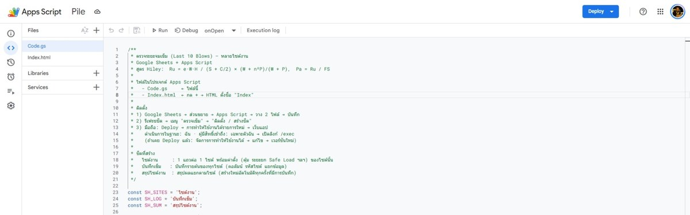
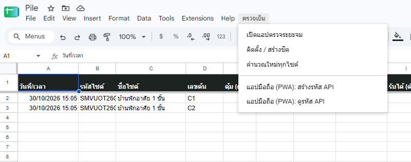
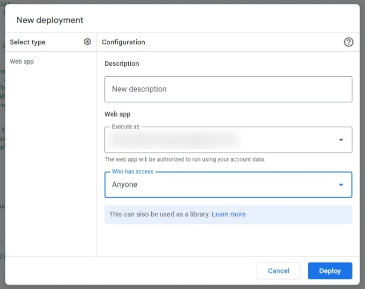
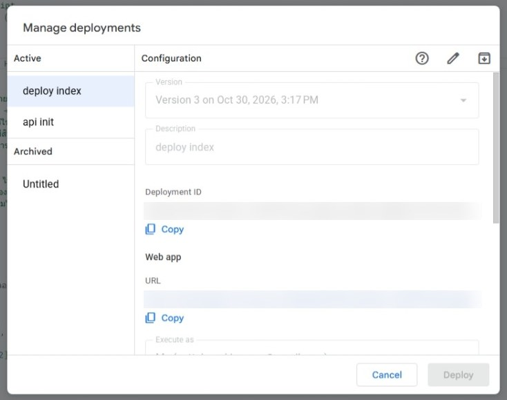
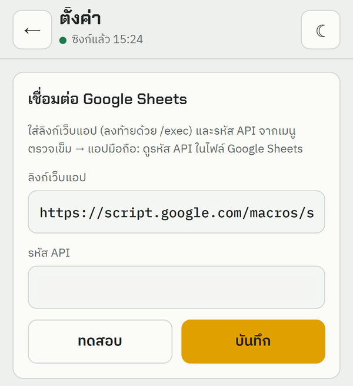
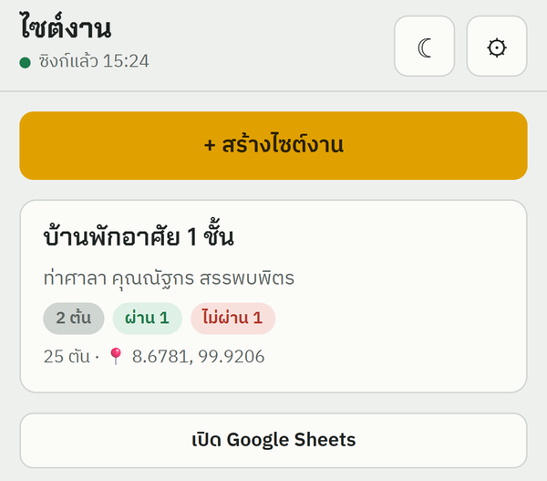
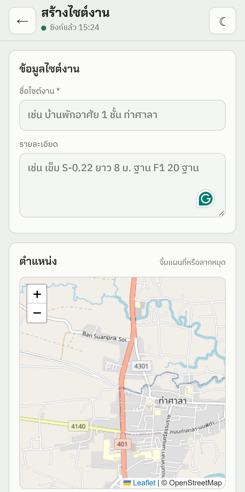
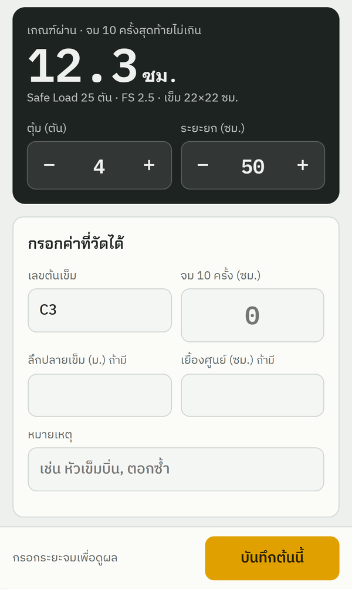
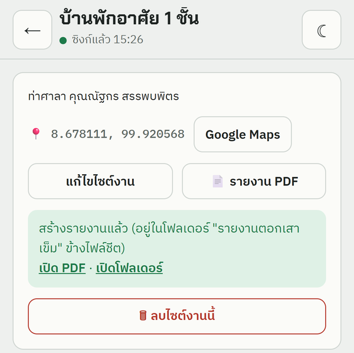
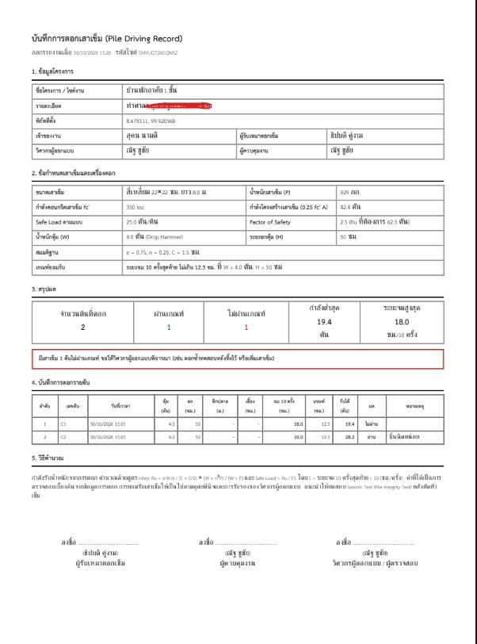

# คู่มือใช้งาน “ตรวจระยะจมเข็ม”

เว็บแอ็พสำหรับบันทึกและตรวจระยะจม 10 ครั้งสุดท้ายของเสาเข็มตอก โดยใช้
Google Sheets ของคุณเองเป็นที่เก็บข้อมูล

เริ่มใช้งานเว็บแอ็พได้ที่

**[ตรวจระยะจมเข็ม](https://nattakorns.github.io/pilecheck/)**

## สิ่งที่ต้องเตรียม

- บัญชี Google
- โฟลเดอร์ใน Google Drive สำหรับเก็บไฟล์งาน (แนะนำให้สร้างแยกตามโครงการ)
- Google Sheet 1 ไฟล์ต่อโครงการ
- ไฟล์ `Code.gs` จากโฟลเดอร์ `apps-script` ในโปรเจกต์นี้

> ข้อมูลที่บันทึกจากเว็บแอ็พจะอยู่ใน Google Sheet ของคุณเอง ไม่ได้เก็บรวมกับ
> ผู้ใช้งานคนอื่น

## ขั้นตอนติดตั้งครั้งแรก

### 1. สร้างโฟลเดอร์และ Google Sheet

1. เปิด [Google Drive](https://drive.google.com/)
2. สร้างโฟลเดอร์สำหรับงาน เช่น `โครงการตรวจเสาเข็ม`
3. เข้าโฟลเดอร์นั้น แล้วสร้าง **Google Sheet** ใหม่
4. ตั้งชื่อไฟล์ให้จำง่าย เช่น `ข้อมูลตรวจเสาเข็ม บริษัท XXX`

### 2. ติดตั้ง Apps Script ใน Google Sheet

1. เปิด Google Sheet ที่สร้างไว้
2. เลือกเมนู **ส่วนขยาย → Apps Script**
3. เปิดไฟล์ `apps-script/Code.gs` จากโปรเจกต์นี้ แล้วคัดลอกโค้ดทั้งหมด
4. กลับไปที่ Apps Script ลบโค้ดเดิมในไฟล์ `Code.gs` แล้ววางโค้ดใหม่ทับ
5. กด **บันทึก**



ไม่จำเป็นต้องคัดลอกไฟล์ `Index.html` หากต้องการใช้เฉพาะเว็บแอ็พมือถือ
ไฟล์นี้ใช้สำหรับเปิดแอ็พเป็นแถบด้านข้างภายใน Google Sheet

### 3. สร้างชีตและ API key

1. กลับไปที่ Google Sheet แล้วรีเฟรชหน้าเว็บ
2. เปิดเมนู **ตรวจเข็ม → ติดตั้ง / สร้างชีต**
3. กดอนุญาตสิทธิ์ตามที่ Google แจ้ง
4. เปิดเมนู **ตรวจเข็ม → แอปมือถือ (PWA): สร้างรหัส API**
5. คัดลอก **รหัส API** เก็บไว้ชั่วคราว



ระบบจะสร้างชีตที่จำเป็นให้อัตโนมัติ เช่น `ไซต์งาน`, `บันทึกเข็ม` และ
`สรุปไซต์งาน`

### 4. Deploy เป็นเว็บแอ็พ

1. ในหน้า Apps Script กด **ทำให้ใช้งานได้ (Deploy)**
2. เลือก **การทำให้ใช้งานได้รายการใหม่**
3. ที่ประเภท ให้เลือก **เว็บแอ็พ**
4. ตั้งค่าให้ตรงกับนี้
   - **ดำเนินการในฐานะ:** ฉัน
   - **ผู้มีสิทธิ์เข้าถึง:** ทุกคน
5. กด **ทำให้ใช้งานได้**



6. หาก Google ขออนุญาต ให้เลือกบัญชี Google ของคุณ แล้วกดยืนยัน
7. คัดลอก **URL ของเว็บแอ็พ** ที่ลงท้ายด้วย `/exec`



ตัวอย่าง URL ที่ถูกต้อง:

```text
https://script.google.com/macros/s/xxxxxxxxxxxxxxxx/exec
```

> ต้องใช้ URL ที่ลงท้ายด้วย `/exec` เท่านั้น ไม่ใช่ URL สำหรับแก้ไข Apps Script
> และต้องตั้ง **ผู้มีสิทธิ์เข้าถึง: ทุกคน** เพราะเว็บแอ็พมือถือจะส่งข้อมูลด้วย
> API key

## ขั้นตอนตั้งค่าเว็บแอ็พ

1. เปิด [ตรวจระยะจมเข็ม](https://nattakorns.github.io/pilecheck/)
2. กดปุ่ม **ตั้งค่า** รูปเฟือง
3. วาง URL ของเว็บแอ็พในช่อง **ลิงก์เว็บแอ็พ**
4. วางรหัสจากขั้นตอนที่ 3 ในช่อง **รหัส API**
5. กด **ทดสอบการเชื่อมต่อ**
6. หากขึ้นว่า **เชื่อมต่อสำเร็จ** ให้กด **บันทึก**



เมื่อตั้งค่าสำเร็จ เว็บแอ็พจะดึงไซต์งานจาก Google Sheet และพร้อมใช้งาน

### ใช้โดยไม่เชื่อมต่อ Google Sheet (โหมดออฟไลน์)

หากไม่ต้องการซิงก์ข้อมูล ให้กด **ตั้งค่า** แล้วเลือก **ใช้โหมดออฟไลน์**
โดยไม่ต้องทำขั้นตอนติดตั้ง Apps Script

- ข้อมูลเก็บในเบราว์เซอร์ของเครื่องนั้นเท่านั้น ไม่ถูกส่งไปที่ใด
- ออกรายงาน PDF ไม่ได้ (ใช้ **คัดลอกสรุปส่งไลน์** แทน)
- ข้อมูลจะหายถาวรหากล้างข้อมูลเว็บไซต์ ลบแอ็พ หรือเปลี่ยนเครื่อง
- เชื่อมต่อ Google Sheet ภายหลังได้ทุกเมื่อ ไซต์งานและบันทึกเข็มในเครื่อง
  จะถูกส่งขึ้นชีตให้อัตโนมัติ

## การใช้งานทั่วไป

1. สร้างไซต์งานจากหน้าแรก
2. กรอกค่าตั้งของไซต์ เช่น น้ำหนักตุ้ม ระยะยก Safe Load และค่า FS
3. เพิ่มข้อมูลต้นเข็มและระยะจม 10 ครั้ง
4. ระบบคำนวณผลรับได้และแสดงว่า **ผ่าน** หรือ **ไม่ผ่าน**
5. ข้อมูลจะถูกส่งไปยัง Google Sheet ที่เชื่อมต่อไว้

| ไซต์งานทั้งหมด | สร้างไซต์งาน | บันทึกค่าเสาเข็ม |
| :---: | :---: | :---: |
|  |  |  |

### ออกรายงาน PDF

1. เปิดไซต์งานที่ต้องการ แล้วกด **รายงาน PDF**
2. ระบบจะสร้างไฟล์ไว้ในโฟลเดอร์ `รายงานตอกเสาเข็ม` ข้างไฟล์ Google Sheet
3. กด **เปิด PDF** เพื่อดูรายงาน หรือ **เปิดโฟลเดอร์** เพื่อดูไฟล์ทั้งหมด

| กดออกรายงาน | ตัวอย่างรายงาน |
| :---: | :---: |
|  |  |

เว็บแอ็พรองรับการใช้งานออฟไลน์ ข้อมูลที่บันทึกขณะไม่มีสัญญาณจะขึ้นสถานะ
**รอส่ง** และจะส่งอัตโนมัติเมื่อกลับมาออนไลน์

> อย่าล้างข้อมูลเว็บไซต์หรือลบแอ็พก่อนรายการสถานะ **รอส่ง** จะถูกส่งครบ

## ติดตั้งไว้บนโทรศัพท์

- **Android (Chrome):** เปิดเว็บแอ็พ แล้วเลือก **ติดตั้งแอ็พ** หรือเลือก
  **เมนู ⋮ → ติดตั้งแอ็พ**
- **iPhone (Safari):** กดปุ่ม **แชร์** แล้วเลือก **เพิ่มไปยังหน้าจอโฮม**

หลังติดตั้งแล้ว แนะนำให้เปิดจากไอคอนบนหน้าจอหลัก เพื่อให้การใช้งานออฟไลน์
ทำงานได้ถูกต้อง

## ความปลอดภัยและการเปลี่ยน API key

- API key จะเก็บไว้ในอุปกรณ์ที่ตั้งค่าเว็บแอ็พ ไม่ได้เผยแพร่ในเว็บไซต์
- ผู้ที่มีทั้ง URL `/exec` และ API key สามารถส่งข้อมูลเข้า Google Sheet ได้
  จึงไม่ควรส่งสองอย่างนี้ให้ผู้อื่นพร้อมกัน
- หากสงสัยว่า API key รั่ว ให้กลับไปที่ Google Sheet แล้วเลือก
  **ตรวจเข็ม → แอปมือถือ (PWA): สร้างรหัส API** เพื่อสร้างรหัสใหม่
- เมื่อสร้างรหัสใหม่ ต้องนำรหัสใหม่ไปเปลี่ยนในเว็บแอ็พทุกเครื่องที่ใช้งาน

## แก้ปัญหาเบื้องต้น

### เชื่อมต่อไม่สำเร็จ

- ตรวจว่า URL ลงท้ายด้วย `/exec`
- ตรวจว่า Deploy ตั้ง **ผู้มีสิทธิ์เข้าถึง: ทุกคน**
- ตรวจว่า API key ตรงกับรหัสใน Google Sheet
- หากแก้โค้ด `Code.gs` หลังจาก Deploy แล้ว ให้สร้าง **การทำให้ใช้งานได้รายการใหม่**
  หรือแก้รายการเดิมให้ใช้เวอร์ชันล่าสุด

### ไม่พบเมนู “ตรวจเข็ม” ใน Google Sheet

รีเฟรช Google Sheet อีกครั้ง หากยังไม่พบ ให้ตรวจว่าได้กดบันทึก `Code.gs` แล้ว
และเปิดไฟล์ด้วยบัญชี Google เดียวกับที่เป็นเจ้าของ Apps Script

### ต้องการดูข้อมูล

เปิด Google Sheet เดิมที่ใช้ติดตั้ง Apps Script ข้อมูลไซต์งานและบันทึกการตรวจ
จะอยู่ในไฟล์นั้นโดยตรง
